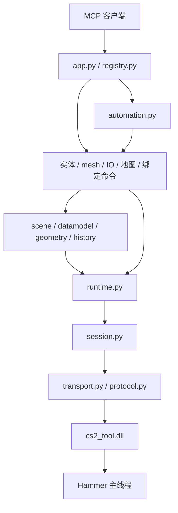

# Hammer MCP 架构

代码根目录：`C:\codex\cs2_tool_mcp`。

## 调用方向



## 模块职责

| 模块 | 负责的内容 |
| --- | --- |
| `app.py` | 创建 FastMCP、CLI、为每个调用绑定会话；唯一导入 MCP 框架的实现模块 |
| `registry.py` | 显式列出 67 个公开工具，不在业务模块使用装饰器注册 |
| `session.py` | 管道生命周期、会话上下文、整次操作互斥、进程地址缓存 |
| `protocol.py` | 请求编码、帧头和响应 ID 校验，限制载荷长度 |
| `transport.py` | Windows 命名管道读写；断线关闭连接，不自动重放请求 |
| `runtime.py` | 内存读写、地址解析、分配释放、主线程函数调用 |
| `offsets.py` | 当前 Hammer 版本的 RVA、结构偏移和相关常量；不含业务操作 |
| `datamodel.py` | DMX 元素句柄、属性和值解码 |
| `scene.py` | 文档选择、场景遍历、父子关系、实体 mesh 归属 |
| `history.py` | Hammer 与 DMX 的撤销记录和撤销/重做 |
| `geometry.py` | 运行时多边形读取、包围盒、坐标解析 |
| `entities.py`、`meshes.py` | 实体及网格编辑操作 |
| `entity_io.py`、`particles.py` | 实体连接及粒子操作 |
| `maps.py`、`bindings.py`、`qt.py` | 地图查询/保存、绑定命令、Qt 辅助读取 |
| `editor_actions.py` | ModelDoc 与粒子编辑器的命名操作 |
| `automation.py`、`results.py` | 跨模块工作流及结构化编辑结果 |
| `diagnostics.py` | 连接、模块、接口和内存诊断工具 |
| `compat.py` | 给既有 injector 脚本保留原来的 Python 导入名称 |

## 维护规则

- 新操作放进所属模块，需要对外暴露时显式加入 `registry.py`。业务模块不导入 `app`、`registry` 或兼容入口。
- 自动化调用 `create_entity`、`create_box`、`attach_mesh`，消费 `EditResult`，不要解析中文报告或从报告提取地址。
- `cs2_*` 适配函数保留原 MCP 参数及报告格式。重构前的完整契约保存在 `tests/fixtures/tool_contract.json`，变更 API 时需明确评审差异。
- 一个 `BridgeSession` 拥有一条管道和一套缓存。`activate()` 为整个工具调用加锁，并恢复上层会话上下文；嵌套服务调用复用同一会话。
- 新连接、连接失败关闭及显式初始化会清除基址、模块、符号、元素表与 Qt 菜单缓存。
- 发送后丢失响应时操作结果不确定。传输层返回错误并关闭连接；调用方检查现场后决定下一步，不自动重试编辑请求。
- 组合创建在开始时选定文档地址，后续创建使用同一文档。失败返回已创建地址并停止；保留原生多步 Undo，不伪装为原子事务。
- 逆向更新地址时修改 `offsets.py`；`injector/_rva_apply.py` 和 `_rva_diff.py` 已指向新位置。RVA 仍依赖特定 Hammer 版本，本次没有引入自动版本适配。

## 兼容入口与验证

`mcp_server/cs2_mcp_server.py` 只负责启动及导出兼容名称。已有客户端配置和常用 injector 脚本继续使用该路径。
通过该入口导入操作不加载 FastMCP；`injector/vm_pipe.py` 已移除伪造 MCP 模块的做法。

```powershell
python -m unittest discover -s tests
python injector/mcp_smoke.py
python injector/mcp_smoke.py cs2_entity_create_brush '{"dry_run":true}'
```

测试覆盖工具契约、mesh 归属、结构化失败结果、会话隔离、缓存失效、无循环依赖、协议验证和写操作不重放。
需要实机工具时，先加载与当前 Hammer 版本匹配的 DLL。模块接口发现现在可用于任何已加载且导出 `CreateInterface` 的 DLL；非编辑器模块不进入 ToolSystem/热键目录。

## Module MCP profiles

`scopes.py` selects editor-specific inventories and binds generic module arguments. `app.py --scope` creates independent stdio servers; services and the injected bridge remain shared. `operation_lock.py` serializes complete calls across Windows MCP processes. See [MCP_MODULES.md](MCP_MODULES.md).
